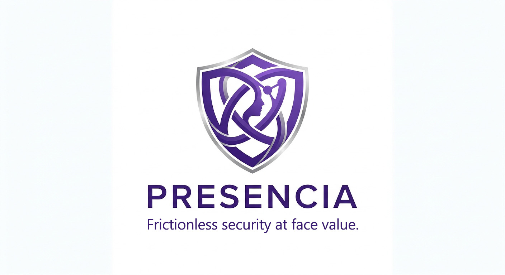
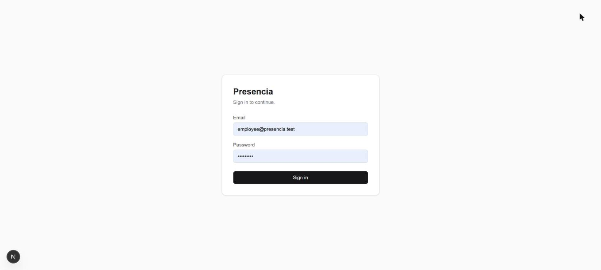
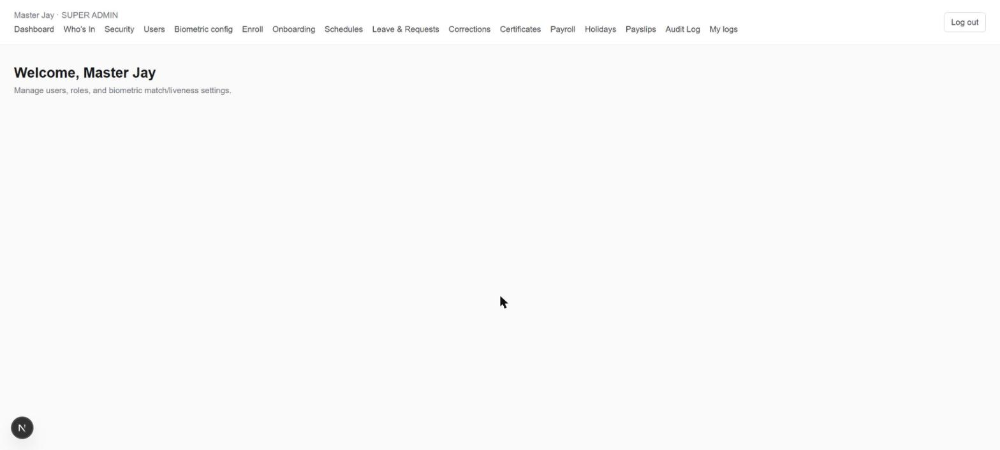
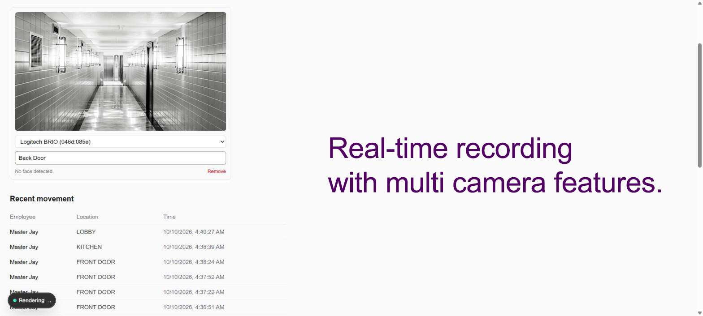
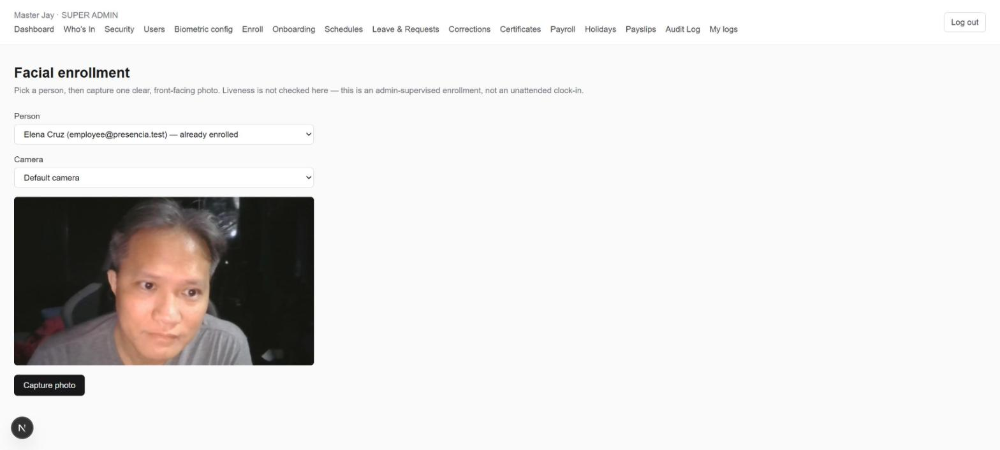

# Presencia

**Frictionless Security at Face Value.**

## About This Project

**Project Name:** Presencia — AppBuildersPH Hackathon 2026

Presencia is a facial-recognition HR attendance system that grew into a
full security platform: contactless, liveness-verified clock-in for
employees, plus multi-camera monitoring that tracks who's moving through
a building in real time — all wrapped around a complete HR suite
(scheduling, leave, payroll, certificates).

**Team Members**
- Jay Ortiz
- Nona Sibayan
- EVIE (AI development collaborator)

### Runs 100% Locally — No Cloud LLM Required

Every AI capability in Presencia — face detection, recognition,
liveness/anti-spoofing, and Security scene analysis — runs as local inference on the machine hosting
it. No frame, embedding, or recognition result is ever sent to an
external API, and the application has no dependency on any cloud-hosted
LLM or AI service to function. It runs entirely on local hardware, even
fully offline.

*One honest exception:* if GPS geofencing is turned on, punches
optionally reverse-geocode coordinates into a street address via
OpenStreetMap's public Nominatim API — a plain mapping lookup, not an AI
service, and the feature works without it (geofence enforcement itself
needs no internet access).

### Models Used

| Task | Model | Notes |
|---|---|---|
| Face detection | MTCNN | Bundled weights, no external download at runtime |
| Face recognition | SFace | 128-dim embeddings, ~37MB ONNX model |
| Liveness / anti-spoofing | MiniFASNet (V2 + V1SE) | Blocks photo/video/mask spoofing |
| Scene objects (Security) | YOLO26m | COCO's 80 classes — people, knives, scissors, bats, bags, furniture |
| Scene relations (Security) | [RelateAnything](https://github.com/Maelic/RelateAnything) ViT-S+ | Open-vocabulary "who is doing what to what" — `person holding knife` |

All three run locally via [DeepFace](https://github.com/serengil/deepface)
on a TensorFlow/Keras backend. Combined footprint is well under 100MB;
confirmed round-trip latency (detect + liveness + recognize) is under a
second on CPU alone, no GPU required.

### Performance Benchmarks — No GPU Required, GPU-Ready If You Have One

The shipped pipeline above runs the full detect → liveness → recognize
round trip in **~0.6 seconds on CPU alone** — no GPU needed for normal
kiosk use.

We also benchmarked faster detector alternatives for a future release,
on the same test image, same machine:

| Detector | Speed | Notes |
|---|---|---|
| **MTCNN** (shipped) | 216.6ms | Current production detector |
| YOLOv8n (COCO, general-purpose) | 29.0ms (CPU) / 9.1ms (GPU) | **Not a face detector** — tested honestly and ruled out; detects generic "person" boxes, not faces, so it isn't a drop-in replacement |
| **YuNet** (OpenCV, face-trained) | 13.2ms | Genuine face detector, ~16x faster than MTCNN, validated as a real upgrade candidate |
| SCRFD (InsightFace, face-trained) | 8.5ms (median) | Also genuine and face-trained; close second to YuNet |

Swapping MTCNN for YuNet in the full pipeline (detect + liveness +
recognize together, not detection alone) measured **~132–152ms warm**,
about **4x faster** than the current ~600ms round trip — validated
end-to-end in testing, not yet shipped in this release.

**On GPU acceleration:** Presencia's models are small enough that CPU is
genuinely sufficient for a single kiosk. We confirmed the architecture
scales cleanly to GPU anyway — on an NVIDIA RTX 5070 (laptop GPU),
detector inference dropped from 29ms (CPU) to ~9ms (GPU), roughly a
**3–4x further speedup** on top of an already-fast model. That headroom
matters most if you're running many cameras against one shared
recognition service (e.g. the Security dashboard's multi-camera
monitoring) rather than a single clock-in terminal.

### Technologies & Frameworks

- **Web app:** Next.js 16 (App Router) + TypeScript, Prisma ORM over
  SQLite, Tailwind CSS, `bcryptjs` + `jose` (JWT sessions)
- **Face engine:** Python + FastAPI + Uvicorn, DeepFace, TensorFlow,
  OpenCV
- **Data security:** Face embeddings encrypted at rest (AES-256-GCM)

### AI Development Tools

This project was built with AI-assisted development throughout — code,
architecture, and debugging work were done in collaboration with
**Claude Code** (Anthropic), referred to on this team as **EVIE**. All
AI-assisted code was reviewed and tested by the team before being
committed.

## Screenshots

| | |
|---|---|
|  |  |
| Sign in | Role-aware dashboard |
|  |  |
| Security — live multi-camera movement log | Facial enrollment |

Three services:

- **`web/`** — Next.js (App Router) + TypeScript + Prisma/SQLite. Handles
  users, roles, schedules, attendance logs, and the kiosk clock-in UI.
- **`face-engine/`** — Python/FastAPI service isolating the ML pipeline:
  face detection, recognition (embeddings), and liveness/anti-spoofing.
- **`scene-engine/`** — Python/FastAPI service for the Security
  dashboard's scene analysis (YOLO26m + RelateAnything, PyTorch/CUDA).
  Optional: without it, Security runs on face recognition alone. Kept
  separate from face-engine on purpose — different ML stacks (PyTorch vs.
  a pinned TensorFlow), so neither can break the other.

## Roles

- **System Administrator** — user accounts, role assignment, biometric
  match/liveness thresholds.
- **HR & Payroll Administrator** — enrolls employees' faces, runs
  onboarding, certificates, and payslips.
- **Department Manager** — assigns schedules to their own direct reports,
  reviews their leave/overtime/correction requests.
- **Regular Employee** — clocks in/out, views their own log, files
  leave/overtime/correction/certificate requests.
- **Kiosk/Device** — a locked-down account for a shared tablet at the
  entrance; no nav, no logout button, camera-only clock-in loop.
- **Security** — runs the multi-camera monitoring dashboard: watches one
  or more physical cameras at once and logs recognized, live faces by
  location automatically, no interaction required, plus scene alerts for
  watchlisted activity.

## Features

- **Facial recognition clock-in/out** — detection (MTCNN) + recognition
  (SFace embeddings) + liveness/anti-spoofing (MiniFASNet), with a
  verify-then-choose kiosk flow (identify a face, show status, let the
  employee pick Time In/Break Out/Break In/Time Out themselves).
- **Multi-angle face enrollment** — HR captures up to five reference
  angles per person (straight ahead, slight left/right, chin up/down),
  each checked by face-engine as it's taken. Every angle is stored as its
  own encrypted embedding, and every kiosk/Security scan is matched
  against all of them, so someone not squarely facing the camera still
  matches. "Add more angles" appends without re-enrolling (new glasses, a
  camera mounted higher).
- **Multi-camera security monitoring** (`/security`) — the newest
  capability, and the one that turns this from a single-kiosk time clock
  into a real facial-recognition security platform. Add any number of
  camera tiles, each bound to a specific physical camera
  (`navigator.mediaDevices.enumerateDevices()` — pick the exact device,
  not just whatever the browser defaults to) and a typed location label
  ("Back Door", "Lobby", "2nd Floor"). Each tile scans continuously on
  its own, runs the same liveness + recognition pipeline as the kiosk (so
  a held-up photo can't fake a sighting), and automatically logs
  **employee, location, and time** the moment it recognizes someone — no
  tap, no confirmation, no kiosk-style interaction at all. A live table
  on the same page shows recent movement across every camera at once. No
  physical door/lock hardware integration yet (that's the planned phase 2
  step) — today it's full visibility into who's where, the access-control
  trigger comes next.
- **Security scene analysis** (RelateAnything) — every Security camera
  frame also goes to scene-engine, which detects people and objects and
  describes how they relate ("person carrying box", "person holding
  knife"). Each tile shows a live one-line description of its scene; a
  recognized person's movement-log entry records what they were doing;
  and anything matching the admin-editable **alert watchlist** (`/config`
  — e.g. `holding knife, climbing, kicking`) is logged as a red **scene
  alert** with camera, time, score, and the person if their face was also
  recognized — or "Unidentified" if not. If scene-engine is down, tiles
  say so and face logging carries on.
- **Attendance rules** — grace periods, overtime, midnight-crossing-aware
  night differential, single-break and daily-total break budgets.
- **Location/network controls** — GPS geofencing and IP/prefix locking,
  enforced before face recognition even runs; every real punch gets a
  location snapshot (lat/lng + best-effort reverse-geocoded address).
- **Rostering** — fixed/flexible/rotating shifts, valid-from/valid-to
  date ranges, group assignment.
- **Leave & requests** — leave (VL/SL/emergency/OB/other) and
  overtime/shift-swap requests with manager/HR/admin approval.
- **Timesheet corrections** — request a missing punch or fix an existing
  one; approval recomputes the same late/OT/night-diff/break flags a live
  scan would produce, and is blocked inside a locked pay period.
- **Audit log** — every leave/overtime/correction decision and
  pay-period lock/unlock, timestamped with who and why.
- **Payroll cut-offs** — lock a pay period, export computed hours to CSV,
  or push them to a configured payroll/HRIS webhook.
- **Who's In dashboard** — live per-person status (on-site, on break,
  late, on leave, absent, done for the day), with live-ticking worked/
  break timers.
- **HR onboarding + Certificate of Employment** — job title, department,
  hire date, employment status, compensation, and benefits per employee;
  employees request a COE (General, Government Transaction, Bank/Loan, or
  Visa/Travel), HR approves, and the certificate text is generated
  automatically from a point-in-time snapshot of the onboarding record.
- **Payslips with real Philippine Labor Code premium pay** — holiday
  calendar (Regular/Special Non-Working), and auto-suggested earnings/
  deductions computed from real attendance using the actual Labor Code
  rate table (ordinary OT 125%; rest day 130%/169% OT; special non-working
  130%/169% OT, 150%/195% on a rest day; regular holiday 200%/260% OT,
  260%/338% on a rest day; night differential +10% stacked on whatever
  rate already applies). Everything stays editable before issuing; once
  issued, a payslip is locked and point-in-time, same as a certificate.

## Setup

### 1. face-engine (Python)

```bash
cd face-engine
python -m venv .venv
.venv\Scripts\activate        # Windows
pip install -r requirements.txt
uvicorn app.main:app --host 127.0.0.1 --port 8000
```

First run downloads the model weights it needs (MTCNN, SFace ~39MB,
MiniFASNet ~4.5MB total) — needs internet once, cached under
`~/.deepface/weights/` after that.

**Do not upgrade `opencv-contrib-python`/`opencv-python` past 4.10.0.84**
without re-verifying face detection still actually works end to end —
newer 5.x builds silently break DeepFace's YuNet detector wrapper (it
returns zero detections even on an obvious face). This project avoids that
by using the MTCNN detector backend instead. See the comment at the top
of `requirements.txt`.

### 2. scene-engine (optional — Security scene analysis)

Runs inside an existing [RelateAnything](https://github.com/Maelic/RelateAnything)
install (its own virtualenv provides PyTorch with CUDA, `ultralytics`, and
`relsgg`). Install RelateAnything per its README (on Windows: CUDA torch
from the cu130 index first, then `pip install -e ".[hub,detector]"`), then:

```bash
cd scene-engine
<RelateAnything>\.venv\Scripts\python.exe -m pip install -r requirements.txt
<RelateAnything>\.venv\Scripts\python.exe -m uvicorn app.main:app --host 127.0.0.1 --port 8001
```

First run downloads YOLO26m (~42MB) and the RelateAnything ViT-S+
weights from Hugging Face. Uses ~450MB of VRAM on a GPU; falls back to
CPU if there is none (slower). Set `SCENE_ENGINE_URL` in `web/.env` if it
isn't on port 8001.

**License note:** RelateAnything is AGPL-3.0. Presencia calls it,
unmodified, as a separate network service. Review the AGPL's terms before
distributing or offering Presencia commercially with scene analysis
enabled.

### 3. web (Next.js)

```bash
cd web
npm install
cp .env.example .env
# generate SESSION_SECRET and FACE_EMBEDDING_KEY, paste into .env — see the comments there
npx prisma migrate deploy
npm run dev
```

Open `http://localhost:3000`. First visit shows a one-time setup screen to
create the System Administrator account. Create the other role accounts
from `/users` afterward.

The kiosk terminal is `/kiosk` — log in with a `KIOSK`-role account on
whatever device/tablet sits at the entrance, then leave that tab open in
fullscreen. It has no navigation and no logout button by design.

### Requirements

- Node.js 20+, Python 3.11+ (web and face-engine must be running
  simultaneously — the web app calls the face-engine over HTTP for every
  enroll/verify; scene-engine is optional).
- No database server — SQLite is a single file (`dev.db`).
- A camera-equipped browser for enrollment and kiosk clock-in (uses
  `getUserMedia`).

## Verifying the face-engine

`face-engine/scripts/test_pipeline.py` runs real DeepFace inference
(not mocked) against real test images:

```bash
cd face-engine
bash scripts/fetch_test_images.sh
python scripts/test_pipeline.py
```

## Verifying scene-engine and the Security dashboard

`scene-engine/scripts/test_scene_engine.py` runs real YOLO26m +
RelateAnything inference on RelateAnything's own sample photos (15
checks), and `npm run test:security` (in `web/`) drives the Security
dashboard end to end with both engines real and two fake cameras —
movement logging, a scene alert, dedupe, and scene-engine going offline
mid-run (11 checks):

```bash
cd scene-engine
<RelateAnything>\.venv\Scripts\python.exe scripts/test_scene_engine.py
cd ../web
npm run test:security
```

## Stack notes

- **Detection: MTCNN. Recognition: SFace (128-dim embeddings). Liveness:
  MiniFASNet** (via DeepFace's `anti_spoofing=True`, but with our own
  configurable threshold applied to the raw `antispoof_score` rather than
  trusting DeepFace's fixed internal cutoff — see `SystemConfig` in
  `web/prisma/schema.prisma` and `liveness_threshold` in
  `face-engine/app/main.py`).
- Combined model footprint is small (well under 100MB) and runs
  comfortably on CPU or an 8GB-VRAM GPU.
- Face embeddings are encrypted at rest (AES-256-GCM, `FACE_EMBEDDING_KEY`
  in `.env`) — the web app decrypts them in memory only to send to
  face-engine for comparison, never stores them in plaintext.
- JWT session cookie via `jose`, bcrypt password hashing, a DAL pattern
  with `requireRole()` gating every Server Action and route.
- **Pay periods are Manila calendar days, not naive UTC days**
  (`web/src/lib/attendance/pay-period-math.ts`) — a date-only form input
  like "2026-10-09" parses as UTC midnight, which is 8 hours off the
  actual Manila business day it's meant to represent.
